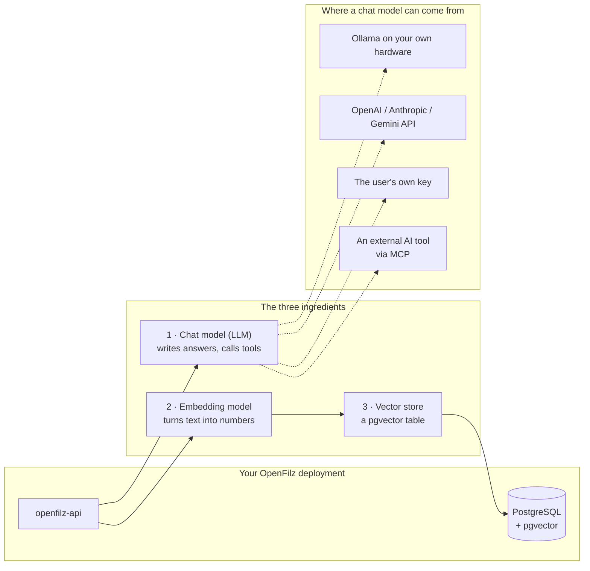
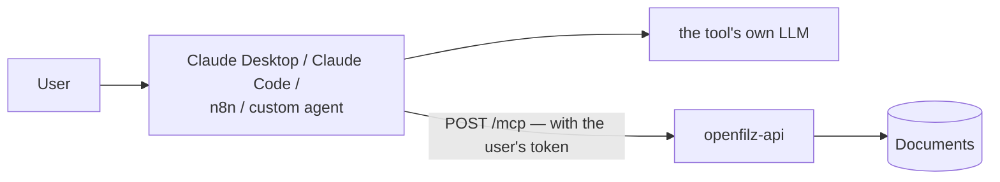

# AI in OpenFilz — what it does, and how to run it without an LLM

This page explains, in plain terms, **what the AI features of OpenFilz do, what each one needs to
run, and what you get when you don't give it a model.** Read it before deciding what to switch on.

| You want | Read |
|---|---|
| The features, and which setup gives you which | **this page** |
| Every property and environment variable | [Admin guide → AI Document Chat](admin-guide.md#ai-document-chat) |
| Connecting Claude Code, Claude Desktop, n8n… | [MCP Server](mcp.md) |
| The REST endpoints | [Developer guide → AI Chat](developer-guide.md#ai-chat) |

---

## At a glance

OpenFilz has four AI capabilities, and they need very different things. **Only two of the lines
below need an LLM inside your deployment:**

| Capability | Who produces the answer | Chat LLM? | Embeddings + pgvector? |
|---|---|---|---|
| Chat inside OpenFilz | an LLM you configure (or the user's own key) | **yes** | **yes** |
| Chat from an external AI tool (MCP) | the tool's own LLM (Claude, ChatGPT, n8n…) | no | no |
| Folder reorganisation, "Organise with AI" | an LLM — yours, or the external tool's | yes\* | no |
| Folder reorganisation "by kind" | plain code | no | no |
| Auto-filing on upload | the most similar documents, then a rule, then (optionally) an LLM | only as a last resort | **yes** |
| Document kind (invoice, contract…) | embeddings, or an LLM | optional | **yes** |
| Summary, keywords, entities | an LLM | yes | no |
| Full-text search | OpenSearch | no | no |

\* No LLM on the server when the reorganisation is driven from an external AI tool over MCP.

> **Where a model is needed, two variables are enough.** Bring your own model and key:
> `OPENFILZ_AI_MODEL=provider:model` (`google:gemini-3.6-flash`, `anthropic:claude-haiku-4-5`,
> `openai:gpt-4o-mini`, `ollama:qwen2.5`) and `OPENFILZ_AI_API_KEY`, next to `OPENFILZ_AI_ACTIVE=true`.
> See [§6.4](#64-choosing-the-model-two-variables).

---

## 1. The three ingredients

Every AI feature is built from three pieces:



**1 · The chat model (the LLM)** writes answers and decides which actions to take. It is the
expensive, optional ingredient. It can run on your hardware (Ollama), behind a cloud API (OpenAI,
Anthropic, Gemini, or anything OpenAI-compatible), be brought by each user with their own key, or
live entirely **outside** OpenFilz in the AI tool that connects over MCP.

**2 · The embedding model** turns a piece of text into a vector, so that "documents that look like
this one" becomes a database query. It is *not* an LLM: it generates nothing and takes
milliseconds. It can run **inside the API** (nothing else to deploy), through **Ollama**, or through
any **OpenAI-compatible** embedding server. It powers semantic search, automatic classification and
auto-filing.

**3 · The vector store** is a table in PostgreSQL, which must therefore run a
**pgvector-enabled image**. No extra service.

> **Choose the embedding model once.** Vectors from two different embedding models cannot be
> compared, so changing it means re-embedding the whole library — OpenFilz refuses to start rather
> than mix them. The chat model, by contrast, can be changed at any time.

---

## 2. Chat

There are two ways to talk to your documents. Both use the **same set of actions** (search, read,
move, rename, PDF tools, e-Sign, reorganisation…), so anything added to one is available in the other.

### 2.1 Chat inside OpenFilz

A panel in the web app. The user asks a question; the answer streams back with clickable links to
the documents it used. Two things happen:

- **Retrieval.** Before the model sees the question, OpenFilz finds the passages of your library
  closest to it and adds them to the prompt. That is what lets the assistant answer *from the
  content* of documents — and why the in-app chat needs embeddings, not just an LLM.
- **Actions.** The model can search, read, move, rename, create folders, merge PDFs, send for
  signature or propose a reorganisation. Every action runs with the **user's own identity and
  permissions** and is audited like a click in the app.

**The assistant is careful with anything irreversible.** A document can contain text written to
manipulate the model, so OpenFilz does not rely on the model's judgement:

- **Deleting** through the assistant only moves to the recycle bin — and without a recycle bin, the
  assistant refuses to delete.
- **Applying a reorganisation** is always the user's click on the proposal card, never the model's.
- **Destructive actions need an exact name.** A partial or ambiguous name gets a list of candidates
  back instead of a guess.
- **Document text is marked as data** wherever it enters the prompt, with an instruction to ignore
  anything it asks for.

Also available:

- **Bring your own key** — each user can plug in their own provider and API key from
  *Settings → AI Assistant*. Keys are stored encrypted and can never be read back.
- **Failover** — when a model is rate-limited, the question is retried on the next model of a list
  you configure. It never applies to a local Ollama model, so document text never leaves your
  premises behind your back.
- **Small local models** — trim the list of actions the chat offers so a 1–3B model stays reliable
  (`openfilz.ai.chat.excluded-contributors` / `.excluded-tools`).

### 2.2 Chat from an external AI tool (MCP)

Instead of running a model, OpenFilz **provides actions to a model you already use**: Claude
Desktop, Claude Code, n8n, a custom agent. The user chats in *their* tool, and that tool works on
OpenFilz.



- **No LLM, no embeddings, no pgvector needed.** The AI tool brings the model; the MCP server can
  be on while every other AI feature is off.
- **Read-only by default.** Actions that change anything are offered only when you switch the
  server to `READ_WRITE`.
- **The AI tool acts as a user** — with that user's roles and audit trail.
- **The Community Edition has no per-document permissions**, so a connected tool sees the whole
  library. Use it single-user or for evaluation.

Setup, per-client configuration and the list of actions: [MCP Server](mcp.md).

### 2.3 Which one to choose

| | In-app chat | External AI tool (MCP) |
|---|---|---|
| Who pays for the model | you (or each user, with their own key) | the user's existing AI subscription |
| Infrastructure to add | an LLM + an embedding model + pgvector | **nothing** |
| Works for a non-technical user | yes, it is a button in the app | needs a configured desktop tool |
| Document text leaves your premises | only with a cloud model | yes — the tool's model sees what it reads |
| Good fit | everybody in the organisation | power users, automation, evaluations, small servers |

They are not exclusive: in-app chat for everyone plus MCP for those automating things works well.

---

## 3. Folder reorganisation

"This folder is a mess — propose a better structure." OpenFilz never reorganises on its own: it
produces a **plan** that you review, tick and apply. A plan is stored (it survives the
conversation), every move re-checks permissions and name clashes and is audited, nothing is ever
deleted, and applied plans can be undone.

There are two ways to get a plan, and only one needs a model:

- **"Organise with AI"** — from the folder toolbar or by asking the assistant. The model sees the
  folder's files (kind, language, summary, last activity) and proposes moves and new folders: by
  client, by project, by year, "archive what nobody opened since 2024"… The same loop is available
  to an external AI tool over MCP, so it works even on a server with no model.
- **By kind — no model at all.** Every folder that mixes several kinds of document gets one
  sub-folder per kind (`Invoices`, `Contracts`…), reusing an existing folder whose name already
  means that kind in any language. Instant and free. It only needs documents to *have* a kind —
  see [§5](#5-document-insights).

---

## 4. Auto-filing on upload

"Drop a file anywhere, OpenFilz puts it where it belongs." It runs only when the user asks — the
*"Let OpenFilz choose the folder"* switch in the upload area — and every filing comes with **Undo**.

OpenFilz decides in stages, and stops at the first one that is sure:

1. **Your rules** — for example the **Inbox**: an optional per-user folder whose content is filed
   against the whole library (`OPENFILZ_AI_AUTO_FILE_INBOX_ENABLED=true`).
2. **The neighbours** — the folders that already hold the most similar documents of the same kind.
   No model.
3. **The kind** — a known kind with no obvious home goes to the folder for that kind, created if
   needed. No model.
4. **The model** — only if nothing above decided, and only when a model is configured. Below its
   confidence threshold, nothing moves and the reason is shown.

On a library that is already well organised, steps 2 and 3 decide most uploads: the model is the
fallback, not the engine. After a batch, a toast shows how many files were filed and opens the list
of where each one went, with an undo per file.

---

## 5. Document insights

Reorganisation and filing both rely on knowing **what kind of document** a file is.

- **File metadata** — title, author, dates, page count, language — is read from the file itself
  during indexing. Free, no model.
- **Enrichment** (`openfilz.ai.insights.active`) adds a **kind** from a list you control (invoice,
  contract, report, CV…), and with an LLM a summary, keywords and entities.

Who decides the kind is up to you, and it is what decides whether the feature needs an LLM:

| `openfilz.ai.insights.classifier` | Who decides the kind | Cost per document | Also produces |
|---|---|---|---|
| `llm` *(default)* | the chat model | seconds | summary, keywords, entities |
| `learned` | your already-classified documents vote | **tens of milliseconds** | the kind only |
| `prototype` | the closest description of each kind | **tens of milliseconds** | the kind only |
| `auto` | `learned` when confident, the model otherwise | mostly local | everything, when the model answers |

On a real library, letting your own documents teach the classifier (`learned`) was measured at
**84–88 % accuracy** — better than a small local LLM, and fifty times faster.

**Users can correct the kind** from the details panel; a correction is never overwritten and teaches
the `learned` classifier. The kind and the language are also **search filters**.

---

## 6. Running OpenFilz without an LLM

**Yes — in three different ways.** And none of this affects the rest of OpenFilz (upload,
versioning, search, e-Sign, PDF tools, audit…): **no AI switch is ever required for the document
management itself.**

### 6.1 The five profiles

| | **A · No AI** | **B · Bring your own AI tool** | **C · Light AI (no LLM)** | **D · Full AI, local** | **E · Full AI, cloud** |
|---|---|---|---|---|---|
| What you set | nothing | `OPENFILZ_MCP_ACTIVE=true` | see [§6.5](#65-recipes) | `OPENFILZ_AI_MODEL=ollama:<model>` | `OPENFILZ_AI_MODEL` + `OPENFILZ_AI_API_KEY` |
| Extra services | — | — | — (embeddings run **inside** the API) | **Ollama** — and a GPU to be usable | — |
| pgvector image | no | no | **yes** | **yes** | **yes** |
| Document text leaves your premises | never | yes — the tool's model reads it | **never** | never | yes |
| Fits a 2 vCPU / 4 GB server | yes | yes | yes (budget a few hundred MB more memory) | no | yes |

How to choose:

- **Just a document manager** → **A**.
- **A small server, and users who already pay for Claude or ChatGPT** → **B**: nothing to install.
- **Automatic classification and filing, and nothing may leave your premises** → **C**: no LLM, no
  GPU, no extra container.
- **The full assistant without sending data to a third party** → **D**: budget a GPU.
- **The full assistant with a cloud model** → **E**; combine with C (local embeddings) so only the
  chat a user opens reaches the cloud.

> A small local LLM is usually the worst of both worlds: it classified *worse* than the library's
> own classifier, and much slower. If the LLM cannot be a good one, prefer C or E.

### 6.2 What each profile can do

| Capability | A | B | C | D / E |
|---|---|---|---|---|
| Full-text search and every document management feature | ✅ | ✅ | ✅ | ✅ |
| Chat in the OpenFilz web app | ❌ | ❌ | ❌ | ✅ |
| Chat from Claude Desktop / Claude Code / n8n | ❌ | ✅ | ✅ | ✅ |
| Semantic search ("documents like this one") | ❌ | ❌ | ✅ | ✅ |
| Automatic document kind | ❌ | ❌ | ✅ | ✅ |
| Summary / keywords / entities | ❌ | ❌ | ❌ | ✅ |
| Auto-filing on upload | ❌ | ❌ | ✅ without the model step | ✅ |
| Reorganisation by kind | ❌ | ⚠️ needs kinds | ✅ | ✅ |
| "Organise with AI" | ❌ | ✅ from the AI tool | ✅ from an AI tool only | ✅ |

### 6.3 The chat kill switch

`OPENFILZ_AI_ACTIVE` turns AI on as a whole. **`OPENFILZ_AI_CHAT_ACTIVE=false` turns off the in-app
chat alone**: the chat button, the chat API, the bring-your-own-key page and "Organise with AI"
disappear, while embeddings, insights, auto-filing, reorganisation by kind and the MCP server keep
working. With the `learned` or `prototype` classifier nothing calls a chat model any more, so you
can run with **no LLM at all**:

```bash
OPENFILZ_AI_ACTIVE=true
OPENFILZ_AI_CHAT_ACTIVE=false
OPENFILZ_AI_INSIGHTS_CLASSIFIER=learned
SPRING_AI_MODEL_CHAT=none          # no chat model is built at all
```

### 6.4 Choosing the model: two variables

The default is **bring your own model and key**. One pair of variables configures it:

```bash
OPENFILZ_AI_ACTIVE=true                         # the master switch — the pair does not turn AI on
OPENFILZ_AI_MODEL=google:gemini-3.6-flash       # provider:model
OPENFILZ_AI_API_KEY=AIza-…                      # that provider's key
```

| Provider | Also accepted | Key |
|---|---|---|
| `google` | `gemini` | required |
| `anthropic` | `claude` | required |
| `openai` | `openai-compatible` (any compatible server, through `OPENAI_BASE_URL`) | required |
| `ollama` | — (`ollama:qwen2.5:1.5b` keeps the tag) | none |

The model becomes the chat model, and the model used for insights and filing unless
`OPENFILZ_AI_INSIGHTS_MODEL` names another one. Embeddings keep their own provider. Provider-specific
variables (`GOOGLE_API_KEY`, `GOOGLE_CHAT_MODEL`, …) still work and take precedence — see the
[admin guide](admin-guide.md#model-one-pair-recommended). A malformed value is ignored with a
warning at startup.

### 6.5 Recipes

```bash
# A — No AI. This is the default.
OPENFILZ_AI_ACTIVE=false

# B — Bring your own AI tool. No model, no pgvector.
OPENFILZ_MCP_ACTIVE=true
OPENFILZ_MCP_MODE=READ_ONLY                         # raise to READ_WRITE deliberately

# C — Light AI: classification + auto-filing, no LLM, nothing extra to deploy.
#     PostgreSQL must run a pgvector-enabled image.
OPENFILZ_AI_ACTIVE=true
OPENFILZ_AI_CHAT_ACTIVE=false
SPRING_AI_MODEL_CHAT=none
TRANSFORMERS_EMBEDDING_ENABLED=true                 # embeddings inside the API
TRANSFORMERS_EMBEDDING_CACHE_DIR=/data/onnx         # mount it: ~140 MB, downloaded once
OPENFILZ_AI_INSIGHTS_ACTIVE=true
OPENFILZ_AI_INSIGHTS_CLASSIFIER=learned
OPENFILZ_AI_AUTO_FILE_ACTIVE=true

# D — Full AI on your own hardware (deploy Ollama; a GPU makes it usable).
OPENFILZ_AI_ACTIVE=true
OPENFILZ_AI_MODEL=ollama:qwen2.5
OLLAMA_EMBEDDING_ENABLED=true

# E — Full AI with a cloud model and local embeddings.
OPENFILZ_AI_ACTIVE=true
OPENFILZ_AI_MODEL=anthropic:claude-haiku-4-5
OPENFILZ_AI_API_KEY=sk-ant-…
TRANSFORMERS_EMBEDDING_ENABLED=true
OPENFILZ_AI_INSIGHTS_ACTIVE=true
OPENFILZ_AI_INSIGHTS_CLASSIFIER=auto
```

Every variable, with its default: [admin guide → AI Document Chat](admin-guide.md#ai-document-chat).
Deploying Ollama: [admin guide → Deploying Ollama](admin-guide.md#deploying-ollama-with-openfilz).

### 6.6 Moving between profiles

- **A → B**: one switch, nothing to migrate.
- **A/B → C/D/E**: PostgreSQL must be a pgvector image (do not switch an existing `postgres:*-alpine`
  volume to the Debian-based pgvector image — dump and restore), then index the existing documents
  from *Settings → AI maintenance* (or `POST /api/v1/ai/embeddings/backfill`).
- **Changing the embedding provider** means re-embedding the library.
- **Changing the chat model** costs nothing.
- **Turning insights on later**: *AI maintenance* (or `POST /api/v1/ai/insights/backfill`) labels the
  existing library.

---

## 7. What you see in the app

The web app shows only what the server has switched on — a feature that is off is simply absent,
never greyed out.

| Element in the app | A | B | C | D / E |
|---|---|---|---|---|
| Chat button | hidden | hidden | hidden | shown |
| *Organise with AI* (folder toolbar, contributors only) | hidden | hidden | hidden | shown |
| *Insights* in the details panel, with the kind | hidden | hidden | kind only | shown |
| *"Let OpenFilz choose the folder"* + *Filed by OpenFilz* + Undo | hidden | hidden | shown | shown |
| Settings → **AI Assistant** (bring your own key) | hidden | hidden | hidden | if enabled |
| Settings → **AI maintenance** (re-embed / re-enrich) | hidden | hidden | shown | shown |
| Settings → **Connect your AI tool** (MCP) | hidden | **shown** | if enabled | if enabled |

---

## Where to go next

- [MCP Server](mcp.md) — enabling it, security, the list of actions, connecting each client.
- [Admin guide → AI Document Chat](admin-guide.md#ai-document-chat) — every property and variable.
- [Developer guide → AI Chat](developer-guide.md#ai-chat) — the REST endpoints.
- [User guide → AI Document Chat](user-guide.md#ai-document-chat) — using the assistant.
